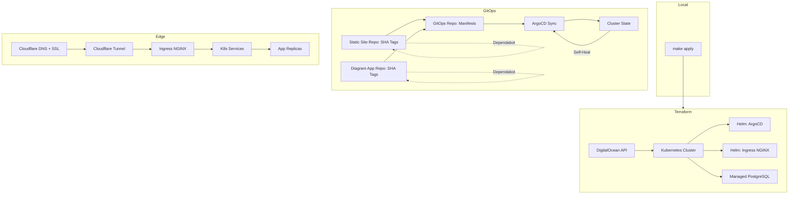

# Summary

I moved a static portfolio and a Mermaid diagram CRUD app from a single Docker Compose Droplet to a 3-node Kubernetes cluster orchestrated via GitOps. Terraform bootstraps everything, ArgoCD reconciles state from a Git repo, and one `make apply` is all it takes to bring both sites online.

---

## The Droplet Era

DigitalOcean Droplet, SSH keys, a Makefile wrapping Terraform. Run `make apply`, Terraform calls the DO API, a single Ubuntu instance comes up with Docker Compose. It worked.

Modular `.tf` files, remote state locking, Ansible roles at 100% Molecule idempotence. tmpfs volumes and read-only filesystems in Compose for defense in depth. Solid for one node.

One node was the problem. If the Droplet died, everything died. Scaling meant duplicating the whole stack. No control plane, no self-healing.

---

## The Kubernetes Threshold

I provisioned a 3-node DOKS cluster and stared at it. The gap between having a cluster and running apps on it is wider than tutorials admit. Ingress, DNS, a deploy path that doesn't involve SSH and `docker compose up`.

ArgoCD bridged that gap. Installed via `kubectl` at first, later through the Terraform Helm provider because manual downloads are tech debt. Pointed ArgoCD at a Git repo. That was the inflection point.

---

## The GitOps Contract

GitOps is a reconciliation loop. The cluster pulls from Git and corrects itself, you don't push changes to it.

5 manifests — Deployments, Services, Ingress — with resource limits. ArgoCD picked them up, spun replicas of both websites behind nginx. Watched the deployment lifecycle pane as the cluster aligned to the repo state. No SSH, no `docker exec`.

Replaced the old Docker DNS records. Pointed Cloudflare from the Droplet IP to the Ingress NGINX controller DNS. Traffic flowed. Cluster live.

---

## Architectural Simplifications

- **No cert-manager.** Cloudflare Tunnel handles ingress. SSL/TLS terminates at the Cloudflare edge. I'll revisit when I need pod-to-pod mTLS. Not today.
- **No open ports.** Everything through Cloudflare Tunnel. Attack surface is one encrypted tunnel.
- **No Traefik.** Ingress NGINX is simpler, better documented, known failure modes.

Production would need cert-manager, network policies, internal PKI. My portfolio doesn't. YAGNI.

---

## Two Websites, One Cluster

The portfolio site was easy. Already had a repo for it with the old compose stack, fully stateless. The diagram website was the hard path — Postgres locally in a container, but the managed DO PostgreSQL instance lived in a different network. No VPC peering, no direct route. Just a connection string that led nowhere.

I spent eight hours researching automated migration strategies. Terraform `local-exec` to run migration scripts on apply. Cloudflare Tunnel TCP forwarding. Bastion hosts with pg_dump pipelines. VPC peering between the cluster and managed DB. Docker networks straddling local and cloud. I read the DO managed DB docs cover to cover, mapped out firewall rules and SSL modes, traced through each approach on paper. Every path added complexity. Every approach needed another moving part.

At hour seven I stopped. Closed the docs. Opened a terminal and ran one `psql` command with the connection string. It worked. The problem was never the migration. It was trying to wrap it in automation that didn't need to exist yet.

So I didn't automate it. I wrote `make prod-migrate-up` — a one-liner that calls psql with the right flags and a GRANT statement for database permissions. Manual trigger, no abstraction, works every time.

> Knowing when to stop automating is also engineering.

---

## Immutable Tags and Deploy Keys

**Git SHA tags.** Stopped pushing `:latest`. Deployments now pin exact commit SHAs. Every deploy is deterministic. Rollback is a Git revert.

**SSH Deploy Keys** between the app repos and GitOps repo. PATs expire. SSH keys don't. ArgoCD pulls manifests from GitOps, GitOps reads app repo artifacts via deploy key. No token refresh.

---

## Dependabot

Enabled on both website repos. Scans npm packages and Dockerfile for outdated versions, opens PRs. Boring, automated, catches things before they rot.

---

## The Final State

One `make apply` provisions the cluster, installs ArgoCD and Ingress NGINX via Helm, points ArgoCD at the GitOps repo, and the cluster reconciles. I've run `make destroy` more times than I can count. Every rebuild produces the same state.

---

## What I'd Do Differently

- **DigitalOcean sooner.** They gave me $200 through GitHub Education. I sat on it for months. The credits expire July 31st and now I'm cramming cloud work on a deadline because I don't want to waste free money. Should've started day one.
- **Helm from day one.** Manual `kubectl` + apply before switching to the Terraform Helm provider was wasted iteration.
- **SSH deploy keys sooner.** PAT expiration is a silent failure mode. Deploy keys are set-and-forget.

---

## On the Horizon

Stack is stable. Next layer is optional:

- **KEDA** for event-driven autoscaling.
- **External Secrets Operator** to pull creds from a vault.
- **Kyverno** for admission control and policy enforcement.
- **StatefulSets** if I migrate to k3s and need durable storage.
- **S3-compatible blob storage** for DB backups outside the managed snapshot schedule.

---

# Conclusion

The migration was not about Kubernetes. It was about expressing infrastructure as data that a cluster can converge toward, instead of steps a human must execute. The Git repo is truth. The cluster converges. The engineer stays out of the runtime loop.

Reduced toil. Zero manual steps between commit and traffic.
