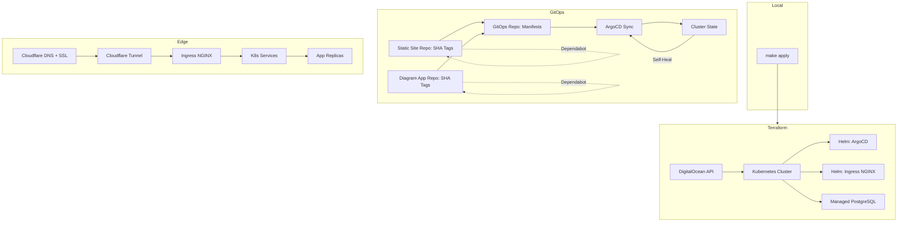

# Summary

I had $200 in free DigitalOcean credits expiring. Two websites on a single Droplet, no redundancy, SSH-dependent deploys. I needed to move them before the money evaporated, and honestly? I needed an excuse to learn real infrastructure. Managed Kubernetes, GitOps, automated deployments. Three weeks later I had a 3-node cluster, ArgoCD reconciling from Git, and zero reasons to SSH into anything ever again.

---

## The Droplet Era

DigitalOcean Droplet, SSH keys, a Makefile wrapping Terraform. Run `make apply`, Terraform calls the DO API, a single Ubuntu instance comes up with Docker Compose. It worked.

Modular `.tf` files, remote state locking, Ansible roles at 100% Molecule idempotence. tmpfs volumes and read-only filesystems in Compose for defense in depth. Solid for one node.

One node was the problem. If the Droplet died, everything died. Scaling meant duplicating the whole stack. No control plane, no self-healing.

---

## The Kubernetes Threshold

I provisioned a 3-node DOKS cluster and stared at it. Empty cluster, no apps. Needed ingress, DNS, a deploy path without SSH and `docker compose up`.

ArgoCD bridged that gap. Installed via `kubectl` at first, later through the Terraform Helm provider because manual downloads are tech debt. Pointed ArgoCD at a Git repo. That was it.

---

## The GitOps Contract

GitOps is a reconciliation loop. The cluster pulls from Git and corrects itself, you don't push changes to it.

5 manifests — Deployments, Services, Ingress — with resource limits. ArgoCD picked them up, spun replicas of both websites behind nginx. Watched the deployment lifecycle pane as the cluster aligned to the repo state. No SSH into nodes, no manual `kubectl apply`.

Replaced the old Docker DNS records. Pointed Cloudflare from the Droplet IP to the Ingress NGINX controller DNS. Traffic flowed. Cluster live.

---

## Architectural Simplifications

- **No cert-manager.** Cloudflare Tunnel handles ingress. SSL/TLS terminates at the Cloudflare edge. I'll revisit when I need pod-to-pod mTLS. Not today.
- **No open ports.** Everything through Cloudflare Tunnel. Attack surface is one encrypted tunnel.
- **No Traefik.** Ingress NGINX is simpler, better documented, known failure modes.

Production would need cert-manager, network policies, internal PKI. My portfolio doesn't. YAGNI.

---

## Two Websites, One Cluster

The portfolio site was easy. Already had a repo for it with the old compose stack, fully stateless. The diagram website was the hard path — Postgres locally in a container, but the managed DO PostgreSQL instance lived in a different network. No VPC peering, no direct route. The connection string existed but the firewall blocked it.

I spent eight hours researching automated migration strategies. Terraform `local-exec` to run migration scripts on apply. Cloudflare Tunnel TCP forwarding. Bastion hosts with pg_dump pipelines. VPC peering between the cluster and managed DB. Docker networks bridging local and cloud. I read the DO managed DB docs cover to cover, mapped out firewall rules and SSL modes, traced through each approach on paper. Every path added complexity. Every approach needed another moving part.

At hour seven I stopped. Closed the docs. Opened a terminal and ran one `psql` command with the connection string. It worked. The problem was never the migration. It was trying to wrap it in automation that didn't need to exist yet.

So I didn't automate it. I wrote `make prod-migrate-up` — a one-liner that calls psql with the right flags and applies a GRANT for database permissions. Manual trigger, no abstraction, works every time.

> Knowing when to stop automating is also engineering.

---

## Push-to-Deploy: The Full Loop

Pushed a commit to the diagram app repo. Watched GitHub Actions build a multi-arch image, tag it with the commit SHA, push it to GHCR, then automatically update the GitOps repo manifest. ArgoCD detected the drift and reconciled the cluster. New pods spun up with the new image. All of it, one `git push`.

**Git SHA tags.** Stopped pushing `:latest`. Deployments now pin exact commit SHAs. Every deploy is reproducible. Rollback is a Git revert.

**SSH Deploy Keys** between the app repos and GitOps repo. PATs expire. SSH keys don't. ArgoCD pulls manifests from GitOps, GitOps reads app repo artifacts via deploy key. No token refresh.

**GitHub Actions** builds both architectures, tags the image with the commit SHA, updates the GitOps manifest, pushes it. ArgoCD sees the change, syncs the cluster. The whole pipeline from `git push` to live traffic happens without me touching a terminal. First time it completed end-to-end I just sat back and watched.

---

## Dependabot

Enabled on both website repos. Drop a `dependabot.yml` in `.github/`, pick your ecosystems (`npm`, `docker`), set an interval, done. No SDK, no webhook config, no credentials to rotate. GitHub just gives it to you.

It scans every dependency in `package.json` and the Dockerfile against the GitHub Advisory Database, opens PRs with version bumps and release notes. You review, merge, done. Grouped updates mean one PR instead of twenty for minor bumps. Instead of drowning in Dependabot noise you get one clean batch per week.

No more manually running `npm audit` and chasing outdated transitive deps. No more `npm outdated` listing packages I keep putting off. No more Trivy flagging a CVE and digging through changelogs for the fix. Dependabot opened the PR first. First week it caught several outdated transitive dependencies across both repos. Clean PRs. I merged, CI passed, deploy ran. Used to be a third-party SaaS or custom cron job. Now it ships with GitHub.

---

## The Final State

One `make apply` provisions the cluster, installs ArgoCD and Ingress NGINX via Helm, points ArgoCD at the GitOps repo, and the cluster reconciles. I've run `make destroy` more times than I can count. Every rebuild comes out identical.

---

## What I'd Do Differently

- **DigitalOcean sooner.** They gave me $200 through GitHub Education. I sat on it for months. The credits expire July 31st and now I'm cramming cloud work on a deadline because I don't want to waste free money. Should've started day one.
- **Helm from day one.** Manual `kubectl` + apply before switching to the Terraform Helm provider was wasted iteration.
- **SSH deploy keys sooner.** PAT expiration is a silent failure mode. Deploy keys are set-and-forget.

---

## On the Horizon

Stack is stable. Next layer is optional:

- **KEDA** for event-driven autoscaling.
- **External Secrets Operator** to pull creds from a vault.
- **Kyverno** for admission control and policy enforcement.
- **StatefulSets** if I migrate to k3s and need durable storage.
- **S3-compatible blob storage** for DB backups outside the managed snapshot schedule.

---

# Conclusion

The credits expire July 31st. I'll use maybe $50 of the $200. The cluster stays up. I don't need to touch it. That's the easy part.

The real thing I bought was the learning. I walked in knowing Docker Compose and walked out understanding how infrastructure converges toward a declared state. I can put "ArgoCD", "GitOps", "managed Kubernetes" on a resume now — not because I followed a tutorial, because I shipped real traffic through them. That $50 was the best tuition I'll ever pay.
