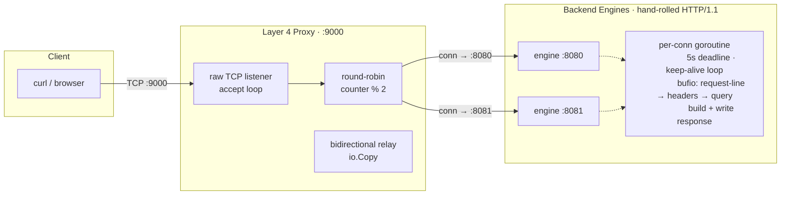

# Summary

This is the story of a deliberately inconvenient project: a monorepo of networking components built from scratch in Go, using nothing but the standard library, begun June 30, 2026. The real focus was a minimal HTTP/1.1 engine I hand-rolled directly on `net.Listen`, `net.Accept`, and `net.Conn`. A Layer 4 reverse proxy and load balancer came later, added to sit in front of it and give the whole thing some room to breathe. No frameworks, no `net/http`, no third-party dependencies. The point was never to build production software — it was to answer a question I'd been carrying for a long time about whether I actually understood the network stack, or whether I'd just been polite to it my whole career.

---

## The Everywhere Abstraction

Every project I'd shipped up to that point ran on someone else's invisible rails. `net/http`, Vercel, Cloudflare tunnels, Nginx as a black-box gateway — they all worked, and I never once resented them for it. They were fast, reliable, and they let me focus on the parts I actually cared about.

But there was a quiet, long-standing discomfort underneath all that convenience. I could describe what a load balancer did in a sentence, but if you'd pressed me on what actually happened to a single byte as it crossed a connection, I would have struggled. What did `net/http` hide from me? What was a reverse proxy really doing at the TCP layer? The abstractions weren't wrong — they were just *hiding*, and I'd never once bothered to look.

This wasn't a sudden storm or a dramatic failure that pushed me over the edge. It was the opposite — a slow, patient itch that had been building for months. The same pattern I'd come to recognize in myself: reach for the tool, trust the blackbox, and call it engineering. Eventually I decided to do the opposite of everyone else. Instead of climbing higher up the stack, I'd dig all the way down — and on June 30, 2026, I opened the repo that would become this monorepo and started building it by hand.

## Why Go, and Why Nothing Else

Go was the obvious choice for one reason: the standard library gives you the raw socket primitives and then gets the hell out of the way. `net.Listen`, `net.Accept`, `net.Conn`, `io.Copy` — every byte crosses my own code before it hits the wire, and no framework is there to hand me a `ResponseWriter` and hide the parsing. I wanted to see the pipeline, and Go was the thinnest curtain I could find.

I set myself a hard rule that became the soul of the project: **standard library only**. No routing framework, no middleware, no HTTP/2, no connection pooling. Not oversights, but deliberate omissions — the features I refused to hide behind so I could understand the layer beneath them.

The architecture was simple and honest. A client opens a TCP connection to the Layer 4 load balancer on `:9000`. The balancer round-robins that connection to one of two backend HTTP engines, on `:8080` and `:8081`, and then does nothing clever at all — it just relays bytes in both directions. Protocol-agnostic by design. It balances raw TCP streams, not HTTP requests, because it has no business knowing what HTTP is.



That diagram is the whole project in one picture, and looking at it I knew exactly what I was signing up for. Every box in it was something I was about to build with my own hands, and for the first time a load balancer wasn't a mystery box on a slide — it was a shape I could see myself wiring together.

## Writing an HTTP Engine Without `net/http`

The L7 engine was the heart of this project, and where I truly had to dig. A raw HTTP/1.1 server built directly on `net.Listen`, `net.Accept`, and `net.Conn` — a per-connection goroutine, a keep-alive request loop, `bufio`-buffered parsing. I had to read the request line, the headers, the query string, and validate every piece of it, because there was no framework to do it for me.

- Raw TCP listener with per-connection goroutines and a 5-second connection deadline
- Keep-alive request loop with buffered parsing
- Request-line / header / query-string parsing with validation
- `GET` and `POST` only, rejecting everything else with a `405`; HTTP/1.1 only, rejecting anything else with a `400`
- Static file serving with MIME detection and directory-traversal protection
- Hand-built response builder and file server
- POST body reads capped at roughly 10 MB via `io.LimitReader`

The parsing was the unglamorous part I'd always taken for granted. The request line gets split on spaces and checked: exactly three parts, `HTTP/1.1` in the third position, and only `GET` or `POST`. Then the query string gets cut at the `?`, split on `&`, validated, and dumped into a map. Headers follow the same pattern, keyed by name. No framework whispered any of this to me — I had to decide what malformed even meant.

```go
// l7-http-engine — the request line, untangled by hand
requestLine, err := reader.ReadString('\n')
requestLine = strings.TrimRight(requestLine, "\r\n")
requestParts := strings.Split(requestLine, " ")

if len(requestParts) != 3 {
    HTTPMessage(conn, "400", "Bad Request", "Too many")
    return
}
if requestParts[2] != "HTTP/1.1" {
    HTTPMessage(conn, "400", "Bad Request", "Only HTTP/1.1 supported")
    return
}
if requestParts[0] != "GET" && requestParts[0] != "POST" {
    HTTPMessage(conn, "405", "Method Not Allowed", "Unsupported HTTP Method")
    return
}
```

And the response was just as naked — a hand-assembled string reported as a `Content-Length`, with `Server: GoLang NixOS TCP/HTTP Engine` signed at the bottom. (Yes, I shipped my distro in my server header. It felt honest.)

```go
// l7-http-engine — what an HTTP response looks like when you write it yourself
serverResponse := "HTTP/1.1 " + statusCode + " " + statusPhrase + "\r\n" +
    "Date: " + time.Now().UTC().Format(time.RFC1123) + "\r\n" +
    "Server: " + "GoLang NixOS TCP/HTTP Engine" + "\r\n" +
    "Content-Length: " + contentLength + "\r\n" +
    "Content-Type: " + contentType + "\r\n" +
    "Connection: " + "keep-alive" + "\r\n" +
    "\r\n" +
    body

myConnection.Write([]byte(serverResponse))
```

Every byte crossed my own code before it hit the socket. That sentence from the README isn't marketing — it was the entire contract I'd made with myself.

## A Load Balancer I Added Afterwards

The Layer 4 component came after the engine, and I'm glad it did — it gave me a reason to look at what I'd built from the outside. It listens on `:9000`, accepts connections in a loop, and keeps a rotating pointer across the two backends. Each new connection gets handed to the next backend in line. Then the real work which I'd been dreading for years turns out to be two lines: relaying bytes in each direction with `io.Copy`.

```go
// l4-rproxy-lb — minimal busy loop, sockets, and a round-robin pointer
backend := backends[next%len(backends)]
next++

// client -> backend
go func() {
    _, _ = io.Copy(backend, client)
    _ = backend.CloseWrite()
}()
// backend -> client
_, _ = io.Copy(client, backend)
```

Deceptively short, but that's the door opening. I stared at that relay and understood something concrete: a reverse proxy at this layer isn't interpreting anything. It's a mirror. It holds a connection open in both directions and lets the bytes flow through, and the moment one side hangs up, it closes the write on the other so the conversation ends cleanly.

And then came the moment I'd actually been digging for. I pointed a `curl` at `localhost:9000`, and watched it round-robin straight into the engine I'd written myself on `:8080`, then relay a real HTTP response back out through a connection I'd wired by hand. The first byte relay worked. There's a particular kind of joy in watching bytes you don't fully deserve cross a socket you built with your own hands, and that was the closest I've come to a dopamine spike in months. The blackbox wasn't a blackbox anymore — it was a mirror I'd constructed, and it was reflecting traffic correctly.

It was protocol-agnostic by construction, and that was a feature. It didn't need to know that the payload was HTTP — it would happily balance raw Telnet or a binary stream. That was when I finally internalized the difference between balancing connections and balancing requests, and why the "L4" in my components actually meant something.

## The Honest Rule About AI

Here's the part that ties this whole project back to everything I've written before, and it's the part I'm most careful about. After two projects where I leaned hard on AI and eventually paid for it with systems I didn't fully understand, this time I set a different, stricter boundary.

I wrote the core logic and conventions entirely myself. AI was the assistant, not the author: it produced syntax, boilerplate generation, and acted as a code-review and critique tool so I could understand the underlying systems better. I hand-picked its implemented advice and investigated its edge cases myself rather than accepting AI-generated fixes wholesale.

But I also learned, in a way that felt deeply human, that AI can be confidently wrong. There was a moment on the path-traversal surface where the AI kept telling me my code was broken. It insisted there was a vulnerability I'd shipped. My defense was a simple containment check on the file-path — building the full path and asserting it stayed under the working directory:

```go
// l7-http-engine — the directory-traversal guard the AI insisted was broken
fullPath := filepath.Join(cwd, filePath)
basePrefix := cwd + string(filepath.Separator)

if !strings.HasPrefix(fullPath, basePrefix) && fullPath != cwd {
    log.Println("Error: File path is outside the allowed directory")
    return
}
```

I read the logic again, and I genuinely didn't think it was broken — I doubted the AI instead of doubting myself. So I stopped arguing and did the only thing that settles technical disagreements: I wrote a test.

```bash
./path_traversal_test.sh   # directory-traversal and injection attempts
```

I ran it, watched it reject traversal and injection attempts cleanly, and then fed those results back to the AI. It went quiet for a beat, and then it admitted it was in the wrong. My code wasn't broken — its confidence was. That was the moment the whole project clicked for me at a different level: I'd let AI critique and generate, but I'd kept the ultimate authority. I verified its claims with my own eyes and my own tests, and when the evidence disagreed with it, the evidence won.

Maybe I've missed something and it's still vulnerable — that's a real possibility, and I say so out loud — but for now the behavior is verified by my own tests, not by an AI's confidence. That distinction mattered more to me than shipping a perfectly secure server ever could.

## What Digging Gave Me

The honest payoff isn't a load balancer. I built a toy TCP proxy and a toy HTTP engine, and I could have `go get` any of it in under a minute. Neither is finished, fully hardened, or production-safe, and I'd be lying if I said otherwise. But I didn't build them to ship them — I built them to understand them, and on that count they've already paid for themselves.

I now know what `net/http` hides, because I rebuilt the slice of it that mattered by hand. I know what a load balancer really does, because I wired the byte relay myself. And every time I reach for the real `net/http` next, or configure another reverse proxy, it won't be a gesture toward a blackbox — it'll be a tool I've seen inside of.

# Conclusion

Everyone is hiding on abstractions these days. It's fast, it's reasonable, and honestly it's usually the right call. But I've learned that sometimes the most valuable thing you can do is refuse to fit in and dig one layer down, just to see. This project was my dig. I got dust in my hands, my engine still has holes, and I'm not sure it's production-safe on a good day — but I understand it, byte by byte, and that understanding is worth more than any framework could have handed me.

The goal wasn't to build something better than the tools that exist. It was to build something I couldn't hide behind, and to prove to myself that I could. The next time someone hands me a perfectly abstracted tool, I'll be the one who knows what's actually underneath it. That's the architectural curiosity I've been chasing, and it turns out all I had to do was dig.

---
