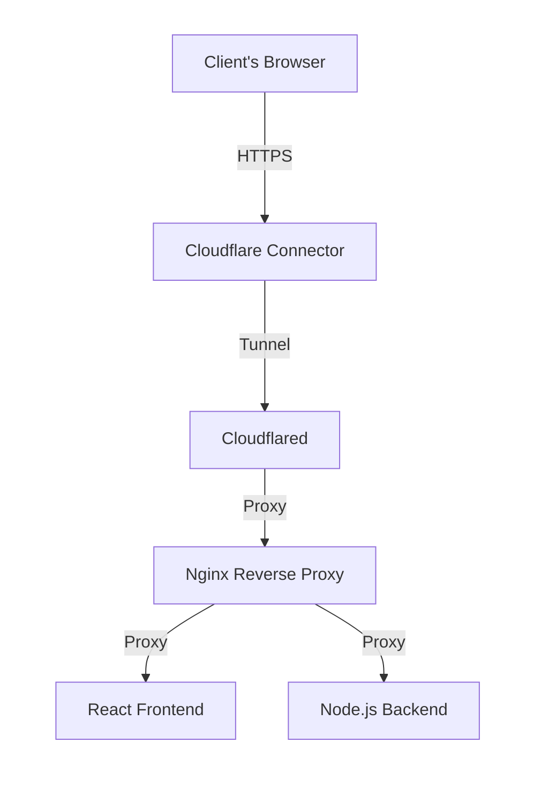

---

# Summary

This document narrates the critical architectural pivot of my portfolio infrastructure—from an abstracted, AI-generated "blackbox" to a deterministic, self-hosted proxy chain on a Raspberry Pi 5. Driven by the paralyzing realization that I did not understand my own production environment, I executed a complete teardown. By manually reconstructing Docker network segmentations, CI/CD pipelines, and raw Nginx configurations, I eradicated my imposter syndrome, replacing it with the hardened confidence of a Systems Architect.

---

# Escaping the Blackbox

The architectural journey began a month prior when I migrated away from expensive, abstracted Vercel infrastructure to a self-hosted Raspberry Pi setup. To compensate for the new self-hosted infrastructure and TSX refactoring, I relied heavily on AI to "vibe code" my networking features, complex integrations, and "good" code suggestions.

At first, AI generation genuinely felt like a superpower. Features were shipping fast. But the abstraction, lack of understanding, and compromised code quality had a hidden cost.

There is a profound, suffocating discomfort in not understanding your own work at the deepest level. The anxiety of taking a brittle, opaque system into production forced me to stop. I had to rip out the complex, unnecessary layers, including my neat little chatbot, and start over from the conceptual bottom.

## The Paradox of Perfectionism

This teardown triggered my old nemesis: perfectionism. I wanted the network to be flawless. I wanted my Ansible playbooks and Pi deployments to be bulletproof. I spent days rigoring my QA process, manually testing rate limits, testing maximum payload sizes, and implementing UFW rules until I was paralyzed by the sheer volume of "what-ifs."

But perfectionism is a double-edged sword. On one hand, it kept me in maintenance mode, endlessly polishing configurations instead of shipping content. On the other hand, it was precisely that paranoia that obsessive need to thoroughly understand the `why` and `how` behind Nginx configs and Docker segmentations. It forced me to learn the very networking foundations that AI had so conveniently fed to me.

## The Proxy Chain

I abandoned garbage, AI-generated proxying rules. Instead, I established a strict, linear proxy chain that I explicitly controlled. Public traffic now hits the Cloudflare Edge, tunnels securely into the internal network via `cloudflared`, lands on a dedicated `Nginx` reverse proxy acting as the edge gateway, and only then gets routed to the internal Vite/React website.

Configuring this manually built muscle memory. I enforced headers, real IPs, and strict network policies, resulting in a flawless HTTP 200 health check and an SSL Labs 'A' rating on the first try. (Because I hadn't implemented all security measures needed inside the Cloudflare Dashboard, I think my HSTS was turned off) [Update: After implementing HSTS headers, I achieved an 'A+' rating on SSL Labs.]

```nginx
# nginx.conf
server {
    # This is just a snippet of the specific server block for the portfolio domain (./nginx/conf.d/portfolio.conf).
    # The full configuration (./nginx.conf) and some h5bp includes provide additional security hardening and optimizations.

    listen 80;
    server_name portfolio.seekeru.tech;

    # Limit request body size for uploads
    client_max_body_size 20M;

    location /api {
        resolver 127.0.0.11 valid=30s;
        set $upstream_backend portfolio-prod-backend;
        proxy_pass http://$upstream_backend:3000;

        proxy_set_header Host $host;
        proxy_set_header X-Real-IP $remote_addr;
        proxy_set_header X-Forwarded-For $proxy_add_x_forwarded_for;
        proxy_set_header X-Forwarded-Proto $scheme;
    }

    location / {
        # Allow only safe methods for static frontend
        limit_except GET HEAD {
            deny all;
        }
        resolver 127.0.0.11 valid=30s;
        set $upstream_frontend portfolio-prod-frontend;
        proxy_pass http://$upstream_frontend:8080;

        proxy_set_header Host $host;
        proxy_set_header X-Real-IP $remote_addr;
        proxy_set_header X-Forwarded-For $proxy_add_x_forwarded_for;
        proxy_set_header X-Forwarded-Proto $scheme;
    }

    include h5bp/basic.conf; # Common security headers and optimizations. The configuration is based on the h5bp project, which provides a set of best practices for securing and optimizing web servers.
    include h5bp/location/security_file_access.conf; # Prevent access to sensitive files
}
```

**Note: Propagating `X-Forwarded-For` explicitly allowed Express to apply `app.set('trust proxy', 1)`, preventing the internal rate limiter from mistakenly blocking the Nginx Gateway IP.**

## Segmenting the Network Boundaries

To enforce these new routing rules, the entire application stack was re-orchestrated into a unified Docker Compose file. We implemented discrete software-defined networks: `edge`, `frontend_net`, and `backend_net`. Containers can only communicate within their assigned lanes, effectively isolating potential blast radius.

```yaml
# compose.yml snippet
services:
  nginx:
    image: nginx:stable-alpine
    networks:
      - edge
      - frontend_net
      - backend_net
    ports:
      - "80:80"

  frontend:
    image: ghcr.io/my-portfolio/frontend:latest
    networks:
      - frontend_net # Cannot be reached directly from the host, cannot reach the backend

  backend:
    image: ghcr.io/my-portfolio/backend:latest
    networks:
      - backend_net # Cannot be reached directly from the host, cannot reach the frontend

networks:
  edge:
    driver: bridge
  frontend_net:
    driver: bridge
  backend_net:
    driver: bridge
```

## Interactive Visuals of the Architecture

Diagrams are worth a thousand words. Visualizing the architectural flow of data and the segmentation of the network makes it much easier to understand the system's design. This mapping helped me internalize the architecture and escape the blackbox. Here is a simplified diagram of the architecture using Mermaid:



## Overcoming Hardware Constraints

Running production workloads on a Raspberry Pi 5 introduces severe hardware constraints, specifically storage capacity and IOPS exhaustion. Building images natively on the Pi previously resulted in bloated 1GB monsters that choked deployments.

The architectural solution was to entirely offload the Continuous Delivery process. I implemented a GitHub Container Registry (GHCR) pipeline utilizing Docker Buildx with QEMU for simultaneous multi-architecture (ARM/AMD64) compilation.

Furthermore, I integrated Trivy for automated CVE and secret scanning. Recognizing that achieving "zero vulnerabilities" is an unattainable ideal that blocks production, I implemented a pragmatic blast-radius mitigation strategy. By explicitly bypassing unpatchable, low-impact base-image CVEs (e.g., `musl`, `zlib`) via a `.trivyignore` file, deployments remain rapid while fully guarded against critical application-level threats.

```yml
# Push multi-arch to GHCR, then pull and run on the Pi
- name: Push multi-arch image to registry (amd64 + arm64)
  uses: docker/build-push-action@v4
  with:
    context: ./backend
    file: ./backend/Dockerfile
    push: true
    platforms: linux/amd64,linux/arm64
    tags: |
      ${{ env.IMAGE }}:${{ github.sha }}
      ${{ env.IMAGE }}:latest

# Trivy execution: High/Crit only, ignore unpatchable base image CVEs
- name: Create .trivyignore file
  run: |
    echo 'CVE-2026-33671' >> .trivyignore # picomatch vulnerability

- name: Scan image with Trivy (fail on HIGH/CRITICAL)
  run: |
    docker run --rm \
      -v /var/run/docker.sock:/var/run/docker.sock \
      -v ${{ github.workspace }}/.trivyignore:/.trivyignore \
      aquasec/trivy:0.41.0 image --severity HIGH,CRITICAL --exit-code 1 ${{ env.IMAGE }}:${{ github.sha }}

# Note that you should also smoke test the image before pushing to production.
```

## Conclusion

At some point during the endless cycle of `docker compose down` and `docker compose up`, muscle memory took over. Staring at raw Nginx blocks and configuring the Cloudflare tunnel manually made me understand the flow of data across my infrastructure in a way that AI generation never could.

Accepting that AI output is not a substitute for systemic comprehension was a brutal but essential lesson. I am deliberately carving my path toward becoming a Systems Architect. True security and competence do not come from firewall rules or generated code; they come from relentlessly interrogating the blackbox until it no longer exists.
