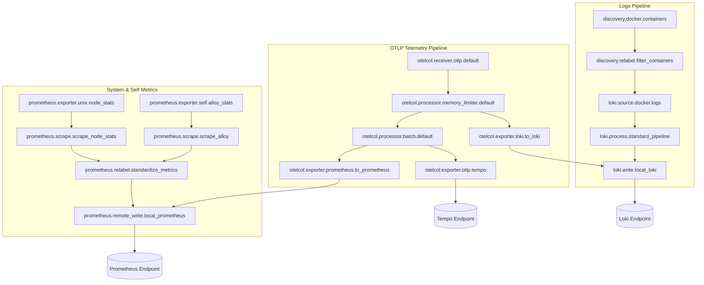

---

# Summary

In this blog, I outline the journey of creating a fully functional observability stack on a Raspberry Pi 5, leveraging the power of LGTM (Loki, Grafana, Tempo, and Prometheus) combined with Alloy as a universal data plane. This project evolved from a minimal implementation to a robust industry-standard configuration, all while navigating the challenges of resource-constrained hardware. The result is a system capable of comprehensive monitoring—tracking logs, metrics, and traces—augmented by proactive alerts to ensure insights are actionable.

---

## Envisioning Observability

The journey began with a vision to unify system metrics, logs, and traces for my Raspberry Pi 5 lab. The initial plan involved integrating Loki, Grafana, Tempo, and Prometheus with Alloy and AlertManager for alerts. However, I quickly realized that jumping into a full implementation would introduce complexity, so I started with an MVP—a minimal stack consisting of Grafana, Prometheus, and Alloy. This allowed me to focus on core functionality while keeping the project manageable.

---

## Debugging and Initial Challenges

One of the most challenging early tasks was routing node metrics to be scraped correctly by Prometheus. This five-hour debugging session became an exercise in learning how to debug effectively with AI tools, leveraging better logging and refined prompts. While it highlighted my dependence on AI for troubleshooting, it also reinforced the importance of treating it as an assistive tool rather than a crutch.

---

## Building the Full Stack

With the MVP functioning, I shifted my focus to implementing industry-standard configurations. Adding Tempo and Loki finalized the LGTM stack, and integrating Alloy transformed it into a unified data plane for OTLP ingestion. This architectural setup enforced strict memory limits and WAL persistence to suit the hardware constraints of the Raspberry Pi 5.

Security was a significant aspect of the design. Initially, open ports were used for testing, but these were transitioned to an isolated internal Docker bridge (shared-obs) to minimize the attack surface. This deliberate change ensured a more secure and production-ready environment.

---

## Highlights of the Final Architecture

- **Unified Data Plane**: Alloy was configured to serve as the universal data ingestion point.

- Example Config(only Prometheus):

```alloy
prometheus.exporter.unix "node_stats" {
  procfs_path = "/host/proc"
  sysfs_path  = "/host/sys"
}

prometheus.scrape "scrape_node_stats" {
  targets         = prometheus.exporter.unix.node_stats.targets
  forward_to      = [prometheus.relabel.standardize_metrics.receiver]
  scrape_interval = "60s"

}

prometheus.exporter.self "alloy_stats" {
}

prometheus.scrape "scrape_alloy" {
  targets    = prometheus.exporter.self.alloy_stats.targets
  forward_to = [prometheus.relabel.standardize_metrics.receiver]
}

prometheus.relabel "standardize_metrics" {
  forward_to = [prometheus.remote_write.local_prometheus.receiver]

	rule {
		target_label = "collector"
		replacement  = "alloy"
	}

  rule {
    target_label = "instance"
    replacement  = sys.env("HOSTNAME")
  }

  rule {
    target_label = "job"
    replacement  = "node"
  }
}

prometheus.remote_write "local_prometheus" {
  endpoint {
    url = "http://prometheus:9090/api/v1/write"
  }
}
```

- **Alerts and Proactive Monitoring**: Alerts for resource monitoring (memory/CPU) and state monitoring (e.g., InstanceDown) were implemented, with notifications sent to a Slack channel.
- **Automated Log Discovery**: Docker logs and system-level stats were integrated seamlessly, ensuring no critical data was missed.
- **Trace Verification**: I validated the system using Python-based OTLP producers and manual cURL commands to ensure trace propagation and log indexing functioned as expected.
- **Hardware Optimization**: Memory and CPU usage were tightly managed to operate reliably within the Raspberry Pi's constraints.

---

## The Roadblocks and Research

Building such a system required digging deep into documentation, videos, and forums. One major roadblock was the lack of up-to-date configurations provided by AI tools for this stack. This experience underlined the value of engaging with community knowledge and understanding from first principles rather than relying solely on prepackaged solutions.

---

## Achieving Pro Observability

The final implementation delivered a robust observability stack that realizes the goals I set out with. The system now provides:

- Complete visibility into lab infrastructure through logs, metrics, and traces.
- Proactive alerts to maintain the health and functionality of monitored systems.
- A scalable foundation for extending observability as projects grow in complexity.

- Diagram of the Alloy config and overall scope:



---

# Conclusion

This project was an exercise in disciplined architecture and persistence. It taught me the importance of balancing simplicity and functionality, leveraging AI intelligently while remaining prepared to do the manual legwork. With these lessons, I have not only built an effective observability solution but also deepened my skills as a systems architect.

---
