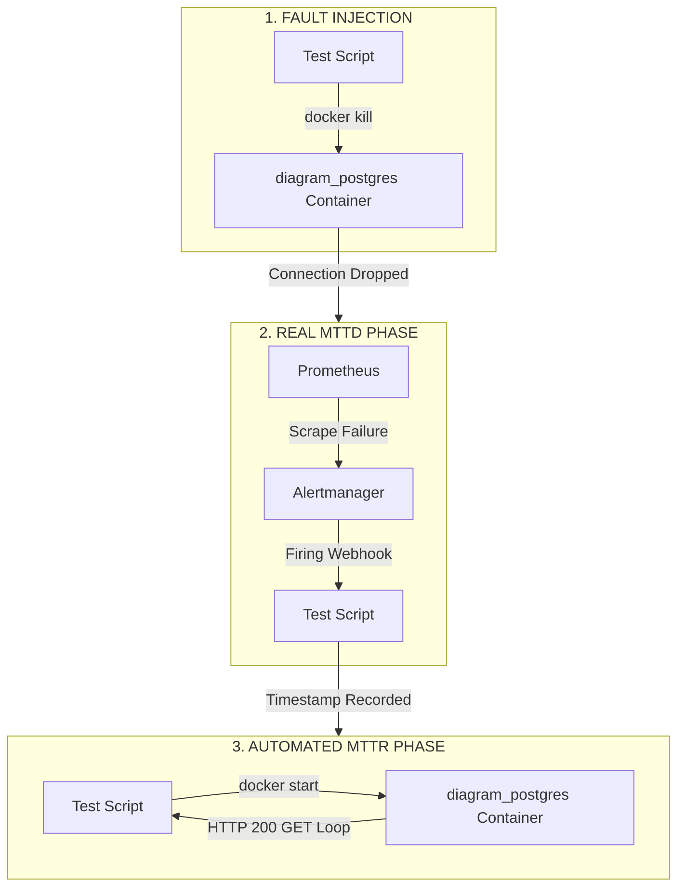

---

---

# Summary

I killed a live database container and measured exactly 5.8 seconds of total outage—from `SIGKILL` to HTTP 200. All timestamps utilize `time.time_ns()` to avoid floating-point drift; millisecond precision matters when measuring sub-second recovery.

> This blog post covers an experiment where the application is containerized, under zero load, and running with intentionally aggressive Prometheus/Alertmanager scraping and evaluation intervals that are not production-safe.

```yaml
- alert: PostgresDown
  expr: up{job="postgres"} == 0
  for: 0s # <-- Unrealistically aggressive for production, but necessary for this experiment
```

If you want to follow along with the code and implementation details, you can check out the full repository on GitHub [here](https://github.com/notseekeru/diagram_website).

---

# The Problem: Understanding MTTD and MTTR in Practice

I often treat core Site Reliability Engineering (SRE) metrics like Mean Time to Detection (MTTD) and Mean Time to Resolution (MTTR) as straightforward statistical aggregations. In reality, they are usually calculated from imprecise, noisy signals that can be delayed by network latency, processing queues, and alerting thresholds. To truly understand these metrics, I needed to measure them under controlled conditions.

To fix this, I engineered a test script designed to deliberately sever an active container, intercept the exact millisecond monitoring registers the failure, automate the recovery, and calculate the true duration of the outage.



My initial attempts ran into immediate environmental friction. Operating across Windows, Windows Subsystem for Linux (WSL), and Docker introduced subtle routing failures. Webhooks dropped into network problems, and graceful container shutdowns hid true detection. The experiment forced me to truly double check and debug instead of praying and guessing the configs and code will work.

---

# Production Simulation Results

The following telemetry was verified during a clean test execution:

```ini
Forcing immediate termination of container diagram_postgres...
Waiting for Alertmanager to hit webhook on port 9099 (MTTD)...

[SUCCESS] Webhook hit caught at time stamp: 1772824105123456789
Real MTTD (Time to Detect): 2552 ms
Starting container recovery via docker start...
Waiting for service to return a 200 OK...

--- Simulation Metrics ------------------
MTTD (Detection Delay):   2552 ms
MTTR (Alert to Recovery): 3324 ms
MTTRepair (Execution):    2903 ms
Total Service Outage:     5876 ms
-----------------------------------------
```

---

## Technical Deep Dive

### Immediate Termination over Graceful Shutdown

Standard administrative commands like `docker stop` send a `SIGTERM` signal, allowing a containerized application up to 10 seconds to flush buffers, close active connections, and exit cleanly. In a production crisis, systems rarely fail gracefully.

The script run `docker kill`. This sends an immediate `SIGKILL` to the container process. By cutting exporter connectivity instantly, I ensure the calculated MTTD reflects pure observation latency without the inflation.

### Cross-Bridge Network Binding

During early test runs, the webhook receiver running inside WSL failed to log alerts emitted by Alertmanager inside Docker. Standard loopback configurations (`127.0.0.1`) isolate traffic strictly within the virtual container network.

To bridge this gap, the script binds its internal HTTP listener to `0.0.0.0`. Combined with explicit Docker host routing adjustments, this configuration allows Alertmanager traffic to traverse the virtual bridge interface cleanly to reach the observer script.

---

# Environmental Adjustments

### Docker Compose Network Routing

On non-Linux architectures like WSL, containers cannot resolve the host machine via standard internal IPs. I append an explicit routing directive to our infrastructure definition to expose the virtual network gateway:

```yaml
services:
  alertmanager:
    image: prom/alertmanager:v0.25.0
    volumes:
      - ./alertmanager.yml:/etc/alertmanager/alertmanager.yml
    extra_hosts:
      - "host.docker.internal:host-gateway" # <-- Exposes the host machine IP to the container
    ports:
      - "9093:9093"
```

---

# Future Work and Next Steps

Interpreting these metrics in a production context requires rigorous load testing. For Part 2 of this series, I plan to run this exact same failure experiment under deliberate infrastructure strains:

- Emulating 50% and 100% CPU starvation states.
- Executing concurrent user load profiles using Locust.
- Running active database synthetic transaction loading.
- Implementing production-realistic Prometheus scrape intervals and Alertmanager evaluation delays.

---

# Conclusion

By establishing an automated observation layer, addressing cross-subsystem networking gaps, and failures, I eliminate guessing from metrics. I'll run this same experiment under 50%/100% CPU load. Locust Concurrent Users Simulation, Database Synthetic Load Testing, Realistic Prometheus and AlertManager configuration. I will give then another blog and I'll publish the results in part 2.
