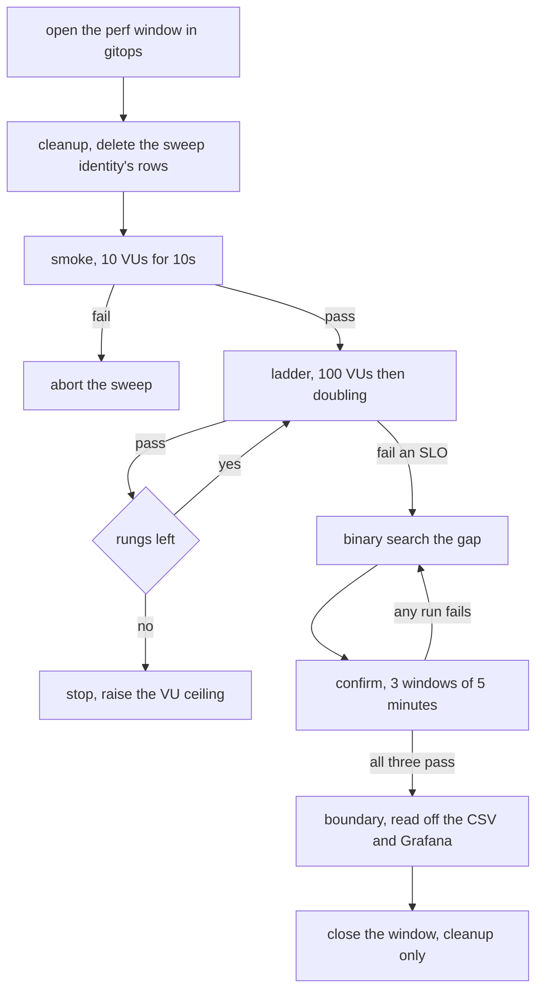

# Summary

Maxterview runs on one Raspberry Pi 5 with one replica, no autoscaler, and a Neon database in another region. I did not know what load that holds, and I had no honest way of finding out, so I wrote the experiment down first and ran it afterwards.

The answer was 10 users at the start, 32 after six changes to round trips, and 55 once the pool went to 40. At 55 it is the p95 gate that fails and not the app, and 70 requests a second is what a single Pi serves while running whole interviews. The boundary is the headline. The part I did not expect to get was knowing how to load test.

---

## The Sequel I Owe From June

[SRE Steps](https://portfolio.seekeru.tech/blog/sre-steps) ended promising part two: the same outage experiment under load, "concurrent user load profiles using Locust", published once it was done. I never used Locust, and the shape changed, but this is that part two, months late.

The gap between the two posts is the thing to admit first. Back then I generated traffic with curl loops and called it a load test. It did what I needed it to do, which was prove that a dashboard moves when traffic moves, and it left me with no idea what my own machine holds. Worse, I could not defend those numbers months later, because nothing in an improvised script records what it measured.

So the specification came before any run this time. At what load does prod stop behaving acceptably, and which resource runs out first. Two questions, and every table below exists to answer one of them.

## Four Models Argue Before A Single Request

The spec took a week, and none of it happened in a terminal. I ran the plan past ChatGPT, Gemini and DeepSeek in parallel, off the same inspiration that started this thread, Arjay McCandless's $12 VPS load testing series, and then had each one audit what the others produced.

That is how the things that do not belong in a capacity test got removed before they could cost me a sweep. A seed script that would have written rows the test then measured. A canary against the real model, where the ceiling becomes a provider quota instead of my pod. A resume upload and a bring-your-own-key path, both of which measure work the sweep is not asking about.

The week was not spent deciding whether to load test. It was spent on questions with no cheap answer: measure through localhost, through Tailscale, or let Cloudflare into the path and then explain how much of the number is edge latency and how much is bot fight mode. Whether NvidiaNIM's quota or Workers AI's neurons would stop the run before my pod did. How much Neon compute the sweep would spend, since it runs against prod's own branch. Which endpoint actually stands for the product. Which numbers were worth capturing at all. The spec that came out of it reads more like a list of refusals than a plan, and that is the compliment I would pay it.

The useful part was not the agreement. Where two of them contradicted each other I had to open the app and read the code, and that is the moment the spec stopped being a model's answer. By the time I ran anything, three other models had already tried to break it.

## Gates Instead Of An Opinion

I set the SLO myself, because the number is only meaningful against a stated bar.

| Indicator   | Gate           |
| ----------- | -------------- |
| p50 latency | reported, none |
| p95 latency | under 1s       |
| p99 latency | under 5s       |
| error rate  | under 1%       |
| throughput  | reported, none |
| correctness | check pass     |

Correctness is the half I would not drop. Latency says nothing about whether an interview actually finished, so every iteration checks that the run was created, the opener streamed to `done`, the transcript holds one reply per user turn, `finish` returned completed, and the feedback came back.

Throughput is reported and never gated, because a level fixes the VUs and the RPS falls out of the app's own latency. A gate there would fail a level for answering slowly, which p95 already does.

The model routes sit outside the latency gates for the same reason the alert rules exclude them. With the model stubbed, the ceiling there is a vendor's quota, not my Raspberry Pi.

## The Sweep, And Why Only One Window Counts

A sweep is the whole experiment. A step is one level inside it, and every step is a 30 second ramp, a 60 second hold at the target, then a 3 minute measurement window. Only the window counts. Gating a ramp measures the ramp.

The smoke is the rig's own check and it is not optional. Ten VUs for ten seconds, before any rung, and a failure there aborts the sweep because the app or the generator is broken and no number after it means anything.

The one time I skipped it, I turned a sixteen second check into a five minute failed level and spent the rest of the night reasoning about a capacity result that was really a broken run. It is the cheapest lesson in the post.

Between steps the sweep waits 60 seconds: fifteen of silence, up to thirty of cleanup, fifteen more. That gap stays inside asyncpg's idle close and inside Neon's scale to zero, so the gap costs neither the pool nor the compute wake. The cleanup runs under the sweep's own identity, which is why one account is what every window starts from.

## The Laptop Said Hundreds

Before touching prod I ran the whole workload on my laptop against the stub, and it passed at 100 VUs. So I went in expecting a number in the hundreds, on hardware far worse than the machine I deploy on, and prod failed the very first rung.

| Target | VUs | Window | p50   | p95    | max   | rps  | Verdict |
| ------ | --- | ------ | ----- | ------ | ----- | ---- | ------- |
| laptop | 10  | 10s    | 2.4ms | 11.6ms | 288ms | 54.0 | pass    |
| prod   | 10  | 3m     | 155ms | 654ms  | 2.80s | 16.7 | pass    |
| prod   | 20  | 3m     | 205ms | 1.25s  | 17.6s | 21.6 | fail    |
| prod   | 100 | 3m     | 1.17s | 3.44s  | 8.54s | 38.3 | fail    |

Three of my instincts were wrong in the same direction. I blamed my own rig. I assumed there had to be something wrong in the code. I trusted the laptop number over the box I actually deploy on.

What settled it was the machine being bored. At 100 VUs it sat at 0.27 of four cores and 134Mi of a 256Mi limit, with an error rate of zero, which leaves a queue as the only explanation for a 3.44s p95. That number is also the reason the three golden signals I had been staring at for months finally said something useful: the box was not the problem and the signal proved it.

## Where The Tail Actually Lived

I went looking for a slow query and there was none. The slowest statement stayed under 2.12s at p99, which cannot explain a 17.6s max at 20 VUs.

The tail was routes paying several round trips in a row, each one its own checkout from a pool of ten. Analytics at 4.8s p95 across five sequential queries. Templates at 3.8s with a seed write before its read. Usage at 2.9s across two.

So the fix was never the queries. Six changes, all of them on round trips, read size or the pool:

| Change             | Before                    | After                          |
| ------------------ | ------------------------- | ------------------------------ |
| `/stats/analytics` | five checkouts            | one statement                  |
| `/templates`       | a seed write, then a read | the read, seeded only if empty |
| `/usage`           | two checkouts             | one                            |
| `GET /interviews`  | every run the owner had   | 50 per page, archived filtered |
| Home counters      | derived in the browser    | one statement                  |
| pool               | 10                        | `DB_POOL_MAX`                  |

The list read is the one I want to be honest about. It grew inside every window, 159 rows at 10 VUs, 241 at 20, 415 at 100, and it was never the slowest route in the report. Pagination shipped because the code was wrong, not because a measurement earned it. The N-sweep that would have settled it never ran.

## Pagination Before Redis

The order between those two was deliberate. A `LIMIT` and an `OFFSET` is a change to a query I was already making. Redis is a second compute to keep alive and a cache to invalidate, and it never appears in the same step as a missing `LIMIT`.

There is a second reason it stayed out. If I had added a cache before the first run, I would never have known what the app costs without it, and every number after that would be a number about my cache instead of my product.

Not having it also gave the pool something to reveal, which is the next section.

## The Pool Was The Queue

After the six changes the bottleneck moved to the one place the app could not fix: the pool of connections.

At 20 connections and 100 VUs, 505ms of a 719ms p50 was spent waiting for a connection, while the mean query time stayed flat between 97 and 116ms across every window. The database never slowed. The queue formed because a request's two or three queries arrive in a burst, and ten or twenty checkouts cannot absorb a burst.

Raising the pool to 40 turned 55 VUs from a failure into a pass and cut the wait at 100 VUs from 505ms to 209ms. Raising it to 80 made the app slower at the tail while removing the wait entirely.

| Pool | VUs | Verdict | p95    | rps  | Wait p50 | Query mean | Memory |
| ---- | --- | ------- | ------ | ---- | -------- | ---------- | ------ |
| 20   | 55  | fail    | 1.096s | 50.0 | 170ms    | 112ms      | 50%    |
| 40   | 55  | pass    | 832ms  | 70.3 | 5ms      | 150ms      | 52%    |
| 40   | 100 | fail    | 1.64s  | 66.7 | 209ms    | 163ms      | 56%    |
| 80   | 100 | fail    | 1.87s  | 75.0 | 6ms      | 248ms      | 74%    |

Read the two 100 VU rows next to each other. At 80 connections nothing waits for a connection, and the request p95 gets worse anyway, because every query now runs against a busier Neon. The mean query goes from 163ms to 248ms and the pod's memory from 56 to 74 percent of its limit.

Pool capacity is connections over mean query time, so 20 gives 172 queries a second, 40 gives 245, and 80 gives 323. Each doubling buys less than the one before, 43 percent then 32 percent, and the tail and the memory pay for it. A warm `SELECT 1` from inside the pod is 37ms at the median, so co-location could save that floor and could never save the inflation.

Forty ships. The pod's memory is what caps the pool, and Neon's compute is what inflates as it grows.

## What The Boundary Is Worth

| When       | Config                      | Passed once  | rps there | First fail |
| ---------- | --------------------------- | ------------ | --------- | ---------- |
| 2026-10-22 | pool 10, before the changes | 10           | 17        | 20         |
| 2026-10-23 | optimized changes (pool 20) | 32           | 50        | 55         |
| 2026-10-23 | pool 40                     | 55           | 70        | 100        |
| 2026-10-23 | pool 80                     | 55 (latency) | 71        | 100        |

55 is the SLO boundary and not the product ceiling. At 100 VUs the error rate stays under one percent and p99 is inside its gate, while p95 and the checks fail. The app keeps serving past the number, it just stops being acceptable by my own definition of acceptable.

A VU is a whole interview compressed into about 21 seconds, which is why the rps number is the one to keep. 70 requests a second is real enough for one Pi with no autoscaler, holding full interviews with a database in another region.

## The Noise I Cannot Attribute

Some windows lose a few chat streams. 56 in 7,794 iterations, 0.72 percent, and not evenly: 29 in one 55 VU window and zero in another at the same level.

The failed requests left no line in the app's access log when I checked, and the app logged no errors, so the drop is most likely on the sweep path itself, the laptop, Tailscale and the NodePort. Production does not use that path.

It matters out of proportion to its size because the checks gate is binary. One dropped opener fails a level, which is exactly how 55 VUs at pool 80 reads as a failure at an 820ms p95 that passes the latency gate. So the next change is not a looser confirmation, which would cost me more than it saves. It is gating correctness at a rate and keeping the number honest.

## What This Number Does Not Cover

Every measurement here went through the NodePort on the backend Service, which bypasses ingress, the tunnel and Cloudflare. That answers what my pod and its database can do, and it says nothing about what a real user pays at the edge. The edge sweep is the next run and it will not be comparable to these numbers, which is the point of running it.

It also measures one shortcut. Every virtual user is the same identity so that cleanup has one owner, the model is stubbed, and hardcore mode is off. A real deployment is many people at once with authentication in the path, so the next architecture gives each VU its own identity and measures it.

One pod, one node, no failover, one fixed traffic shape, and no unit economics anywhere in it. What I have is where it stops, not what an interview costs me to serve.

The full sweep is also paused, because Neon's compute sits at about 90 percent of its limit. One three minute window ran after that pause, and nothing else has.

# Conclusion

The number I can defend is 55 VUs at 40 connections, with 10 confirmed and 32 and 55 single windows, and 70 requests a second behind it. The number I would not have had a month ago is any of them.

What changed is method, not heroics. A spec written before the runs. Gates that fail a level instead of a chart I form an opinion about. A smoke that refuses to let a broken rig become a capacity result. Recording what the number excludes, since the edge, the model and real users are all outside this one.

The three fights I enjoyed were the same three that hurt: keeping the document honest when the evidence moved, reading what the pool numbers actually meant, and building a rig I could trust enough to blame the app.

Next is the edge sweep, correctness gated at a rate so one dropped stream cannot lie about a five minute window, per-VU identities with auth back in the measured path, and eventually the cache question I keep postponing. Every one of those is a run I now know how to set up.
