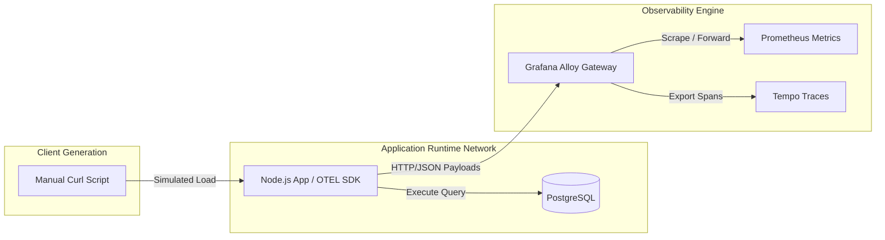

# Summary

This document details the architectural evolution of my application observability—shifting from an opaque, AI-generated Go monitoring template to a hand-built, deterministic OpenTelemetry (OTLP) pipeline. Confronted by a total lack of visibility and transport-layer failures, I stripped the infrastructure down to a Node.js Minimum Viable Product (MVP). By implementing explicit HTTP/JSON telemetry transport, manual curl smoke-testing, and Grafana Alloy debugging, I gained deep systemic understanding. Ultimately, validating this pipeline via a manual chaos engineering experiment exposed a critical, unconfigured database connection pool bottleneck that had previously masked system failures and inflated recovery metrics.

---

# The Illusion of Telemetry

The project began with a clear objective: implement the "Four Golden Signals" (Latency, Traffic, Errors, and Saturation) to monitor a core Go application. To accelerate the setup, I relied on an AI assistant to generate the initial instrumentation, Grafana Alloy configurations, and dashboard components.

On the surface, it looked complete. Code was injected, and an intricate dashboard template was provisioned. But the moment the infrastructure was spun up, the entire system went completely dark.

There is a distinct anxiety that comes with looking at an empty dashboard, realizing you don't actually understand the syntax or the underlying telemetry lifecycle of the language you are trying to monitor. I was treating observability as a magic blackbox, expecting data to seamlessly flow without understanding the explicit pipes, serialization, or transport protocols handling the payloads. The AI-generated code obscured the fundamental truth of how context propagation and span lifecycles actually work. To fix the network, I had to drop back down to an MVP environment where every dependency and configuration line was explicitly accounted for.

## Shifting to a Lean MVP

To isolate the transport pipeline from my lack of deep Golang syntax familiarity, I shifted the producer stack to Node.js. The goal was simple: master the telemetry lifecycle, context tracing, and data routing using a language I knew intimately before introducing complex concurrent runtime metrics.

I stripped the data collection down to bare essentials, focusing exclusively on two core signals: **latency metrics** and **distributed traces**. To accomplish this without relying on heavy, automated magic, I mapped out the minimal required OpenTelemetry SDK packages, ensuring each served an explicit architectural purpose:

- `@opentelemetry/sdk-node`: The foundational runtime initializer that manages the tracer and meter provider lifecycles.
- `@opentelemetry/api`: The global interface used to manually create spans, handle context propagation, and track active executions.
- `@opentelemetry/exporter-trace-otlp-http`: The explicit transport layer used to serialize and push in-memory span buffers to our collector via HTTP/JSON.

By grounding the application in these core dependencies, I eliminated the ambient noise of auto-instrumentation and forced myself to explicitly write span boundaries and handle context tracing manually.

## Debugging the Transport Layer

The first major architectural wall was the ingestion transport protocol. The initial AI template defaulted to gRPC for data ingestion into Grafana Alloy. However, the application completely failed to register any ingestion signals, silently dropping telemetry packets without clear error context.

This failure highlighted a massive gap in my understanding of telemetry network boundaries. I realized I didn't know how the data flowed from the application runtime, past the network bridge, and into Alloy’s receivers.

To break out of this debugging blind spot, I reconfigured the entire pipeline to use explicit **HTTP/JSON** transport, bypassing the strict connection state constraints of gRPC. I modified the docker-compose topology and the application environment to expose live telemetry logs, turning up the internal debugging verbosity of both Alloy and the Node.js SDK.

```yaml
# compose.yml snippet showing live telemetry debugging environment
services:
  node-app:
    image: node:24-alpine
    environment:
      - OTEL_LOG_LEVEL=debug
      - OTEL_EXPORTER_OTLP_ENDPOINT=http://alloy:4318
      - OTEL_EXPORTER_OTLP_PROTOCOL=http/json
    networks:
      - telemetry_net

  alloy:
    image: grafana/alloy:latest
    volumes:
      - ./config.alloy:/etc/alloy/config.alloy
    ports:
      - "4318:4318" # OTLP/HTTP receiver
    command:
      [
        "run",
        "--stability-level=public-experimental",
        "/etc/alloy/config.alloy",
      ]
    networks:
      - telemetry_net
```

Before writing a single line of Node.js production code, I needed absolute proof that the Grafana Alloy receiver was listening and functional. I bypassed the application layer entirely and executed a raw, manual `curl` smoke-test payload directly into the Alloy HTTP endpoint.

```bash
curl -X POST http://localhost:4318/v1/traces \
  -H "Content-Type: application/json" \
  -d '{
    "resourceSpans": [{
      "resource": {
        "attributes": [{"key": "service.name", "value": {"stringValue": "smoke-test-pipeline"}}]
      },
      "scopeSpans": [{
        "spans": [{
          "traceId": "4bf92f3577b34da6a3ce929d0e0e4736",
          "spanId": "00f067aa0ba902b7",
          "name": "manual-pipeline-validation",
          "kind": 1,
          "startTimeUnixNano": "1716048000000000000",
          "endTimeUnixNano": "1716048001000000000"
        }]
      }]
    }]
  }'
```

The moment that manual span cracked through the transport layer and populated inside my Tempo instance, the blackbox shattered. I had proven the integrity of the network path.

With verified data arriving in both Prometheus and Tempo, I mapped out a localized configuration for Grafana Alloy to explicitly process the incoming HTTP stream, binding the application boundaries together:

```alloy
// config.alloy
otelcol.receiver.otlp "default" {
  http {
    endpoint = "0.0.0.0:4318"
  }
}

otelcol.exporter.prometheus "local" {
  forward_to = [prometheus.remote_write.local.receiver]
}

otelcol.exporter.otlp "tempo" {
  client {
    endpoint = "tempo:4317"
    tls { insecure = true }
  }
}

otelcol.forwarder "default" {
  output {
    metrics = [otelcol.exporter.prometheus.local.receiver]
    traces  = [otelcol.exporter.otlp.tempo.receiver]
  }
}
```

## Stress-Testing the Dashboard Boundaries

With data flowing deterministically, I built a tailored Grafana dashboard tracking the application layer alongside its database interactions. I intentionally avoided concurrent generation utilities like Locust, opting instead to write custom loop-driven `curl` execution scripts. I wanted to see the immediate, real-time relationship between a single executed thread, system latency spikes, and the corresponding metric adjustments in my Prometheus graphs.

This granular, hands-on volume validation confirmed that my telemetry pipeline was highly accurate under standard load. Spans accurately tracked HTTP handler executions, database query durations, and trace linkages across application boundaries.



## Chaos Engineering and the Postgres Blackout

Confidence in your infrastructure is meaningless until you try to break it. To transition from basic monitoring to proactive engineering, I designed a simple chaos experiment: a **Postgres Blackout**. I abruptly disconnected the state backend by executing a raw container halt:

```bash
docker compose stop postgres-prod
```

The objective was to observe how the application handles an immediate backend dependency loss and to verify if the 'Errors' and 'Latency' dashboard components accurately signaled the outage. What the experiment uncovered was a devastating architectural flaw.

The dashboard did not instantly flash red with error spikes. Instead, the application’s latency signals climbed slowly, while errors remained flat. The system was experiencing a silent degradation.

By digging directly into the active trace spans during the blackout, I discovered that the application lacked a proper database connection pool layout. Without explicit limits and timeout barriers, the backend driver defaulted to retrying connections indefinitely within an unmanaged loop without throwing an error back up to the runtime handler.

### The Impact on Detection Metrics

This unconfigured retry behavior severely impacted my critical response metrics:

- **Mean Time to Detection (MTTD):** Masked entirely. Because the errors were caught in an endless driver-level loop, the application continued to return delayed, hanging pending states instead of immediately failing. The HTTP layer waited indefinitely, preventing the error threshold alerts from triggering for over 30 seconds.
- **Mean Time to Recovery (MTTR):** Artificially prolonged. By allowing connections to pile up silently during the outage, the application exhaustively consumed local thread runtimes, delaying the application's ability to cleanly re-establish stable database states once the container was restarted.

This failure proved that observability is not just about measuring static, healthy code; it is about exposing how your system behaves under extreme duress.

This made my previous metrics of MTTD and MTTR meaningless. The system was not failing gracefully, and the telemetry pipeline was not capturing the true state of the application under stress.

---

# Conclusion

Dropping back to the bare essentials of the OpenTelemetry transport protocol taught me that complex monitoring templates mean nothing if you cannot track a single payload through your pipeline.

Relying on abstract, pre-packaged AI layouts created a false sense of security that crumbled under the first sign of network friction. True architectural confidence is built by executing manual curl assertions, reading raw configuration specs, and intentionally breaking your database infrastructure to see where the telemetry breaks. The absolute clarity of my operational dashboard did not come from elegant visualization layers—it was forged by completely dismantling the blackbox from the bottom up.

---

## Update (June 5, 2026)

You can check the other blogs that I wrote about, including the following iterations and updates related to this current project. Link at [SRE Steps](https://portfolio.seekeru.tech/blog/sre-steps).
