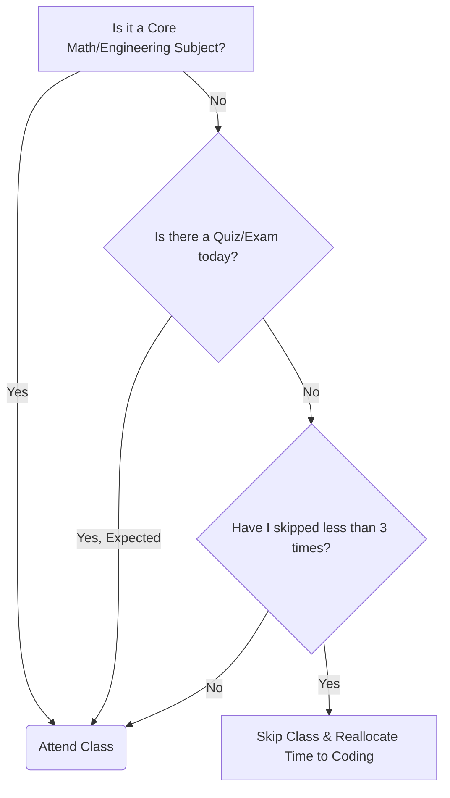

---

# Summary

This document outlines the architecture of my daily workflow and how I manage my compute time as a university student. It covers my personal battles with procrastination and ego, my metacognitive approach to self-discipline, and the logic behind min-maxing university requirements in the Philippines. By engineering my environment from dopamine regulation to calculated absenteeism. I have bypassed the traditional learning curve to achieve extreme growth.

---

## 1. The Morning Startup: Booting the System

The morning you wake up is the first execution cycle of your day. The voice prompting you to go back to bed is technical debt incarnate. Wasting cycles thinking, `"Should I go back to sleep?"` is a missed learning opportunity. From the moment you wake up, you must enforce execution.

`You are what you think.` If you think and act like a disciplined System Architect, you will adapt the habits and intuition of one. Nobody is ever truly "ready" to take on hard problems; you don't wait for the right time, you execute even when you don't feel ready. Comfort zones are obsolete. Adaptation and enthusiasm are the new meta.

---

## 2. The Three Pillars of Immense Growth

True growth is an architecture built on three load-bearing pillars:

- **Discipline:** The infrastructure. It is required for the boring, unexciting tasks. It carries the weight when enthusiasm fails.
- **Obsession:** The engine that drives deep-dives into complex rabbit holes. Ensures you have the stamina to push through the inevitable frustration of learning something new.
- **Motivation:** The initial spark and the glimpse of unwavering joy.

Without Discipline, the entire system crumbles. Motivation gets you started, Obsession accelerates you, but Discipline ensures the system stays online during a failure state.

---

## 3. Demoting the Legacy System (University Curriculum)

In the Philippines, university programs often run on legacy curricula bound by excessive General Education (GE) subjects driven by cultural norms rather than industry alignment. I made a structural decision: I view the university not as the primary source of truth, but as a supplementary system to fill knowledge gaps.

The degree is simply an API key to bypass HR filters. My processing power goes entirely to math, software-hardware, and core engineering subjects. Memorization-heavy GE classes receive the absolute minimum viable effort required to pass.

---

## 4. The Logic of Strategic Absenteeism

Time is my most expensive resource. I treat mandatory attendance overhead like an error budget in Site Reliability Engineering. You are permitted roughly three absences per class before facing penalties.

Here is my exact risk assessment matrix for skipping class:

This is a high-risk, high-reward protocol. You skip expected discussion days on GE subjects to reclaim hours of focused engineering work. However, this is not perfect due various factors(eg. attendance grade, missed groupings, unexpected announcements, etc.). You must track it flawlessly so a surprise requirement doesn't crash your grade.

---

## 5. Metacognitive Regulation and Commute Optimization

Fear stems from leaving your "comfort workflow." Exploring new tools will inevitably lead you down dead-end rabbit holes where you waste hours configuring something that doesn't work. But those scars are invaluable heuristics. Ego is a double-edged sword—you must know when to push, and when to proudly say, `"I am not fit for this right now,"` to cut your losses.

To survive the grind, I optimize my environment:

1. **The Commute Node:** Internet connectivity on transit is unreliable. I pre-download high-density documentation and offline resources. My travel time is compiled into pure study time.
2. **Hacking Dopamine:** I run periodic social media detoxes to lower my dopamine baseline. I turn boring tasks into streak-based games ("I must because I want to").
3. **The "Mean Mentor AI":** I configured a personal AI agent optimized to brutally critique my code to strict industry standards with zero hand-holding. Gamifying this feedback loop forces me to write cleaner code just to avoid its "wrath."
4. **University Vacancies:** I use university breaks to learn and watch from the sidelines. Utilizing books, documentation, downloaded resources. Since my university has the worst signal of all time. I have no choice but to self-study during these periods, than to waste time trying to do nothing productive.

---

## 6. The Proof: The Freshman Architect

Systems are judged by their outputs. By rigorously applying this architecture and shifting my intuition to ask the right questions, the ROI is undeniable.

At the close of my first year of university while some peers are still actively struggling with basic syntax and introductory logic (not downplaying). I am now entering a 2nd year with a portfolio of projects, a deep understanding of the bigger picture, and the confidence to tackle complex problems. Closing my 1st year at a level where I can apply for an internship after just closing my 1st year. The 9 Months of serious dedication led to a level of growth that would have taken years with a traditional approach.

---

## Conclusion

I am still human. I procrastinate, my discipline occasionally faults, and personal struggles hinder my uptime. But systems are designed to handle faults. By recognizing my limits, applying metacognitive regulation, and relentlessly optimizing my time, I've built a fault-tolerant lifestyle that guarantees compounding growth.
