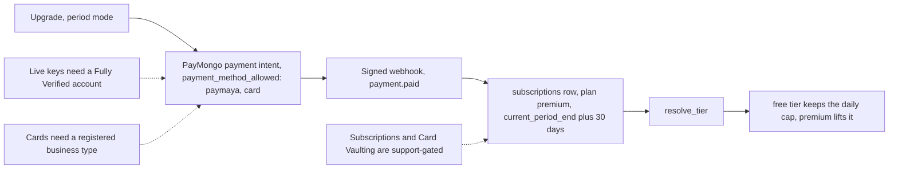
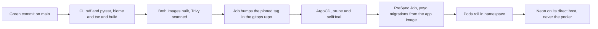
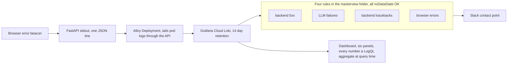

# Summary

Maxterview is an AI interview simulator I built from an empty repository in August and have kept running since. A candidate creates a run, answers over a streamed chat, and gets a graded review with per-answer annotations, ten scored dimensions, a verdict and tips. This is the build log of everything that took, in the order it happened: the repo floor, the no-ORM data layer, the decision to ship one SPA instead of a server-rendered marketing site, the two-stage grader that made ten dimensions possible, the payment provider swap that needed documents and still cannot take money until a separate verification bar is cleared, the entitlements, the production path with its PreSync migration job, resumes as the grounding that stopped the grader inventing things, hardcore mode, a staging environment I built and deleted inside two days with ADR 0003 as the way back, observability that ended up as one log-only pipeline after I deleted Sentry, and a voice path where the interviewer speaks and the applicant talks through what is now a single engine with a measured daily budget.

Three things got deleted along the way. Staging, Sentry, and the browser speech engines. The post keeps them in, because in each case the decision to remove something was the part that made the product better.

---

## The prologue

I had been primarily infra and wanted to test myself on the other half: product and full stack, where the decisions are mine and the polishing is the point instead of the leftover. Not a startup, since I am not that guy. One real product, taken as far as I could take it.

An interview simulator, because it forces the hard parts: voice in both directions, grading that has to be held to something true, runs that carry state, and money at the end. Any wrapper would have done as an excuse. This one refuses to stay one.

The bar was that it looks and feels shipped, which is taller than it sounds when every layer underneath is yours too.

## The Floor, And Deciding Not To Have An ORM

The first week was chore work and I wanted it that way. Three compose files, a shared one plus dev and prod overlays, a digest-pinned Postgres, and CI running ruff and pytest against a Postgres service next to biome, TypeScript and a production build. Renovate owns the dependency pull requests. None of it is interesting, and all of it is the reason later weeks could move.

Migrations went to [yoyo](https://pypi.org/project/yoyo-migrations/) as the Python analogue of node-pg-migrate. My first instinct was to write the rollback inline, under a `-- migrate:down` block in the same file. I watched yoyo treat that block as part of the up step and cheerfully create and then drop my own tables. Every migration since keeps its rollback in a separate `<name>.rollback.sql`, which is uglier and honest.

I did not add an ORM. I would rather read the SQL I am shipping than learn another mapping layer's opinions about joins, and the schema here is small enough that the trade is obviously worth it.

Postgres itself is Neon, not a pod holding a volume. A StatefulSet with a PVC means volume sizing, a restore I have to have actually rehearsed, and a backup job that is correct on the day I need it. Neon is PITR and a restore I did not build, with a free tier that covered the whole build and its own console on top. What I gave up is latency, since every query crosses the network to us-east-1 instead of staying in the cluster, and a second vendor in the critical path. For one database with no users, owning the storage was the more expensive kind of free.

## One SPA Instead Of Two Deployables

The plan had Next.js. I dropped it. The landing page does not need server rendering for anything a static build cannot do, and I preferred one React and Vite and TypeScript application with shadcn/ui and react-router owning both the marketing page and the app itself. One build, one deployable, one place where a route change has to be considered.

The cost is a slightly heavier first load on the marketing page. The gain is that the person who clicks Start free is already inside the app's router rather than crossing a deployment boundary.

## The Loop The Product Actually Is

The product is a loop. Create an interview, chat over server-sent events, complete the run, and land on a review with per-answer annotations, a grade, a verdict and tips, backed by dashboard charts and an archive and delete row menu.

Everything that follows in this post is attached to that loop. That is also why a labelled checkpoint runner drives a real headless browser from the landing page through creating an interview. The browser kept catching regressions the static gate could not see, and paying for that runner once has been cheaper than every debugging session it prevented.

## The Tooling Tax, Or Why The Runner Stops Being The Test

Verifying any of this in a browser meant plumbing, and the plumbing fought back.

Three MCP servers end up wired in `.mcp.json`: the Playwright browser server, Neon over HTTP with its API key read out of the git-ignored `.env` at connect time, and Grafana running from its container image with the transport forced to stdio because it would not stay on the wire otherwise.

The browser server is the one that taught me the most. It comes from nixpkgs through the repo flake rather than npx, wrapped with its own browser path, which means the command only resolves when the agent is started inside the dev shell. The committed journeys have the mirror of the same problem: they need `playwright-core` and a chromium out of `/nix/store`, and a hardcoded store path dies the next time something is garbage collected or the flake moves. A small resolver finds them at runtime instead, so nothing in the scripts assumes a hash is stable.

What wore me down was drift. The journeys were written against the app as it was: a call to action that has since been reworded, a `/app` prefix that no longer exists, a Complete step that got renamed. Each one turns a run into script maintenance before it can tell me anything about the product, and there were weeks where the script was the thing I was debugging.

The fix was not a better script. It was a decision order, written into the skill and left there. Driving the real browser and reading the accessibility tree is a verdict, so that is the default. A canned runner gets run as-is, for its PASS/FAIL line and nothing else. A runner that fails, misses a selector, or lacks the leg I need is a dead end, not a task, and editing one needs an explicit ask. I had already demoted the interactive path to a footnote once and promoted it back a day later, which is why the order is written down now instead of remembered.

## The Payment Rail

I started on Stripe, which is not available to a Philippine individual in the way I needed and carried fees I did not want to absorb. I researched Xendit, then moved the provider seam to PayMongo.

Then I found out that Subscriptions and Card Vaulting are support-enabled capabilities and that even plan creation answers 403 on this account. The rail I wanted, a recurring subscription with a saved card, was not available to me. What was available needed verification, and verification needed documents I did not have sitting in a drawer: a postal ID and a barangay clearance.

That meant going out to get them, which is the undignified part of building a payment integration that nobody documents. What I did not expect was that it would be the best hour of the week. The clerk at the counter was helpful, wished me luck with the project, and processed the clearance for free. I came home with a document and, honestly, with more motivation than I had left the house with. It is the only part of this build that involved a person outside it being kind about it, and it landed on exactly the day the whole thing felt stalled.

The account is verified, and that is where it stops. Taking real money needs a Fully Verified account, which is its own bar with its own paperwork, and live mode on an individual account is narrower than the feature list implies: the app asks PayMongo for `paymaya` and `card`, but only Maya, GrabPay and ShopeePay can be enabled live without a registered business type. So the rail works end to end against real delivered webhooks and it is still not ready, which is a different thing from being live, and I would rather write that down than call the billing done.

### Designing Around A Capability I Cannot Buy

The swap stayed cheap because the entitlement was always mine. One `subscriptions` row, one `resolve_tier` function that reads it, and provider-specific code confined to a single module. When I left Stripe the migration renamed its columns to provider-agnostic names instead of rewriting the schema, because the schema was never about Stripe in the first place.

The recurring rail is blocked, so I put 30 days of premium on the same `current_period_end` field that the recurring path would have written when it exists. The capability block stopped being a blocker and became a gap in the automation. When PayMongo lifts it, the write path already has somewhere to put the answer.



Bring-your-own-key is the other half of the same reasoning. If someone brings their own provider credentials, they skip free cap (still limited to high caps) without changing their tier, so the keys are Fernet-encrypted at rest with only a last-four hint readable back.

## The Grounded Grader And Hardcore Mode

The grader was grading a stranger. It wrote confident feedback about achievements nobody had claimed, because a transcript is all it had. Attaching a resume fixed the root cause: the extracted text becomes the grounding for the questions and the rubric, so the model is measured against what the candidate actually did. The parse is capped at extraction time, pages, size and text, because a large PDF parsed in-process is a way to blow the request budget rather than a feature.

Hardcore mode went the other direction. In a normal run, the judge is a soft signal. In hardcore it runs on every turn and an inaccuracy ends the run as a certain reject instead of a degraded score. It only works because the transcript is grounded, and it is the closest thing the product has to real screening pressure.

The smaller things took the most passes. Per-answer tips landed three times before they were right, block underneath, then popup, then finally a small bulb beside the candidate's bubble at the same height, because the note belongs to that answer and nowhere else. The dashboard plots the newest five runs as an average instead of the last run, so a single bad interview stops pretending to be a trend. The charts mount one at a time through a queue, each slot handed back in the commit that mounted the previous chart, after I watched them all draw at once and cost frames I could see. The chat screen became full bleed with one icon-only composer pill, the microphone inside it, Finish moved into the header, and long answers folded behind a Show more control so a 90 second answer cannot push the reply off screen.

## Production, And The Moment It Was Real

Prod is one Neon project reached over its direct host and not through the pooler, because the pooler is PgBouncer in transaction mode and asyncpg's implicit prepared statements do not survive it. The app runs in its own namespace, and an Argo PreSync Job runs the migrations from the app image before the pods roll, which means a broken migration stops the sync instead of half-deploying.

Promotion is continuous and has no ceremony. Green CI builds both images, Trivy scans them, and a job bumps the pinned tag in the gitops repository.



The click moment of the whole build was not the first payment. It was watching the app answer on its own domain for the first time, knowing the migration job in front of it had run inside the same image the pods were about to start. Everything before that had been verified in pieces. That was the first time the pieces were live at once.

## Staging, Built And Then Deleted

Two days after I finished staging, I removed it, and the removal is the decision I defend.

Staging was a real second environment: its own Neon project, its own Infisical environment, its own Terraform root module and state key, its own namespace, its own ArgoCD Application, and a second frontend image, because the SPA inlines the Clerk publishable key at build time and a different Clerk instance needs a different artifact.

The trap I care about most was inheritance. Prod's database value inherited into staging would have pointed the pods at the production database and let the PreSync migration job run there, so while staging existed, both modules carried a guard refusing the other environment's endpoint. The same shape applied to money: prod's payment key is live, so an inherited value would have put live billing credentials in a rehearsal environment. The lesson is not that typos are dangerous. It is that silence is. A guard that refuses is worth more than a checklist that reminds.

It existed for two reasons, and ADR 0003 only records one. The record says migration rehearsal and load testing, which is true but smaller than the motive: what I actually wanted was the deployment itself, a second environment to practise a production rollout in, hands on, where the decisions were mine to make and a wrong one was cheap. It was never a release gate, since every green commit on main already ships straight to production, and that is the part which did not survive, because practising a rollout you have no users for is still practising. A migration-promotion job for CI/CD was on that list too, and it went with the environment: with one namespace and the migration running inside the app image before the pods roll, there is nothing left to promote between.

What staging actually cost was a mirrored set of roughly 30 secrets kept in sync by hand, a second consumer of a per-project Neon quota, and a class of `MOD` typo that needed cross-refusing endpoint guards in both modules.

There are no users to protect from a bad deploy, and no team to review against a rehearsal target. So it went.

The discipline was in how it went. ADR 0003 records the full rebuild path in order, database and secrets first, then cluster objects, then GitOps, then the image build, with the exact mistakes marked: a missing Infisical folder 404s the write pre-check, environment inheritance in the dashboard does not reach the CLI, and `.` dot-form references are what the API actually reads. Deleting the machinery took an afternoon. Writing down why it was deleted and exactly how to rebuild it took longer, and that document is the difference between a decision and a thing I have to remember. Reversal cost is a day.

The namespace work from the same week stayed, because it had a real fault underneath. Pull secrets never cross namespaces, so every new namespace needs its own `imagePullSecret` or every pod, including the migration Job that gates the Argo sync, sits in ImagePullBackOff while I blame the image. Portfolio and diagram each got their own namespace and their own pull secret, and the DigitalOcean module is gone because a third cloud for one static site was never justified.

## Sentry In And Out

I wired Sentry, verified delivery from a real production bundle, and deleted it in the same session. Its own gap list killed it. Without sourcemaps the stack traces are decoration, and at my traffic an issue feed, grouping and an email channel is a lot of weight. The number that ended the discussion was **146 kB gz on every signed-in load**, paid by users, for a dashboard nobody reads yet.

The one leg it held alone became mine. A render crash swallowed by the error boundary never reaches `window.onerror`, so the boundary reports a browser error by hand, message and component stack, through the backend route everything else uses. That beacon is the entire frontend observability story and it holds no third-party credential.

Sentry comes back the day there are real users and a decision to publish sourcemaps, because symbolication is the thing it is actually for.

## The Agent Prose I Kept Deleting

The other recurring fight was not with the product. It was with the writing my agent left in the repo.

Comments restating the line underneath them. Banner comments sectioning a file that already had file boundaries. Docs explaining what the code plainly said. And in the interface, a caption under the composer explaining that enter sends and shift-enter makes a line break, on a screen I open every day. That last one is what got me, because it is not a wrong comment. It is a comment written for someone who cannot read their own app, and I read the diff.

So the rules became the deliverable. AGENTS.md got rewritten eleven times in six days, eighteen times since August: doc bloat and restatement banned, one owner per fact, minimalism as the default rather than an aspiration, test economy, which says a test that guards no real failure mode is maintenance I have to carry and should be skipped, deletion preferred over addition, and no explainer chrome. That last rule says an interface never explains a control the user can already see, so a shortcut, a format or a limit belongs in a placeholder or a title, where it costs no pixels and cannot go stale against the UI.

The one I use most is the comment test. A comment earns its line only by carrying the why that the code cannot: an invariant, a platform or version trap, an ordering or security constraint, a measured number, a rejected alternative. Everything else goes. Restatement dies. Banners die. Step labels that narrate the next statement die.

There is an uncomfortable symmetry in it. I am the one who taught the agent to write that way, and the instruction file is now longer than most of the files it governs. Constraining the slop meant writing more instructions, which is the trade I said I did not want. The honest version is that AGENTS.md is now the most load-bearing document in the repo, and the only reason it earns the space is that it stands between me and a codebase written for someone who is not reading it.

## A Pipeline With No Metrics SDK

Logs are the only signal, and every number on the dashboard is derived from them at query time.

The app emits structured JSON to stdout through structlog, with a `ProcessorFormatter` bridge so my events and stdlib records, uvicorn tracebacks included, come out as one shape. `request_id` is bound per request and echoed as `X-Request-ID`. Identity is read from `scope["state"]` because the rate limiter's `BaseHTTPMiddleware` blocks contextvars from travelling back up the stack. Health checks are filtered at the source, because the log shaping is the filter.

Shipping is a single Grafana Alloy Deployment, not a DaemonSet, tailing pod logs through the Kubernetes API. No hostPath, no privileged container, no node filesystem. The namespaced Role is the scope, and `own_namespace = true` is mandatory because discovery lists cluster-wide by default, so a namespaced Role without it yields zero targets and a 403 in the Alloy log. The second trap shows up at 2am pace: the migration Job finishes, its pod sits in `Succeeded`, and Alloy re-opens the closed log stream about twice a second, forever, until the relabel rule drops finished phases.

Alloy reads its config at startup, and Argo updating a ConfigMap restarts nothing, so the Deployment carries a config hash annotation that has to be bumped with any edit. That is a footgun I wrote down next to the thing it breaks.

Grafana Cloud Loki holds 14 days of unparsed JSON. Parsing happens at query time, which is what keeps the label set small. Every panel is a LogQL aggregate:

```logql
sum(count_over_time({app="$app"} | json | status >= 500 [$__auto]))

quantile_over_time(0.95, {app="$app"} | json | event="http.request"
  | keep status, duration_ms | unwrap duration_ms [$__auto])

sum(count_over_time({app="$app"} | json | event=~"llm[a-z._]*(unavailable|failed|transport_error)" [$__auto]))
```

Four alert rules live in a `maxterview` folder and route to a Slack contact point. All of them are `noDataState: OK`, which keeps a quiet stack quiet, and also means a rule whose field names do not match my logger never fires and never complains. A quiet stack and a dead rule look identical, which is the failure mode I care about most, so the bootstrap script ends by running a live query against the `app` label and refusing to report success if it returns nothing.

That script is the other thing this work produced. The whole stack is portable now: one Python file recreates the folder, the rule group and the dashboard against any Grafana Cloud organization. It is idempotent, it preserves rule UIDs, and it refuses to write outside a slug pattern. A dashboard assembled by clicking is not infrastructure, and the next project should get most of this from one command.

Two bugs earned their keep during the install. Every panel went red with no data because the `app` template variable had no value, which is invisible until you read Grafana's own UI instead of your own code. And one rule's regex could never match the log line it was written against, found the same way. Neither would have been caught by a test. Both were caught by looking at the screen I was claiming to monitor.



No metric SDK, no trace SDK, and no telemetry credential anywhere near the browser.

## The Fallback That Could Not Work

Voice was the milestone I expected to be easy, and I built it in the wrong order. I planned Cloudflare Workers AI for both directions with the browser's own speech engines as the free fallback, and I built the browser side first because it needed no API key and no new backend route. Right order for shipping, wrong half of the feature to start with.

On my machine it was dead twice over. Brave on Linux exposes no `speechSynthesis` voice without `--enable-speech-dispatcher` and a loadable `libspeechd`, which I proved by loading the library by hand. Recognition answers every attempt with a `network` error, and Brave's own issue tracker says there is no way to detect that before you try, so the first attempt is the test.

What ended it was not the breakage. It sounds like a screen reader, and the interviewer is the product. A generic voice is not a cheaper version of the feature, it is a worse one. I wrote that fallback into the plan in the morning and killed it the next day.

Going cloud only did not throw the day away. The sentence chunker, the playback queue, the take timer and the chat wiring all stayed, and only the two engines that cannot run were removed. I did it in forward commits rather than a reset, so the dead end sits in the log next to the reason it died.

## Where The Neurons Go

Both directions run on Cloudflare Workers AI inside a free allocation of **10,000 neurons per day**, shared by the whole account and reset at 00:00 UTC. I measured it against the live account instead of trusting a pricing page:

| Direction     | Model                    | Measured                                                                                            | Cost                                                                                           |
| ------------- | ------------------------ | --------------------------------------------------------------------------------------------------- | ---------------------------------------------------------------------------------------------- |
| Transcription | `whisper-large-v3-turbo` | 6.8 to 17.5s for a 112 second clip through my own route, upload included, 10 segments, correct text | **87.26 neurons** reported by the response, which matches the published 46.63 per audio minute |
| Voice         | `@cf/deepgram/aura-1`    | 0.42 to 1.03s per sentence, `audio/mpeg`                                                            | 1,363 to 2,727 neurons per 1k characters, estimated from the published rate                    |

The voice is the scarce resource, not the transcription. A day is roughly 2 to 7 runs where the answer budget alone would allow 14. `@cf/myshell-ai/melotts` is the model this account cannot run at all, answering `AiError: Internal server error` (code 3043) on every request while the same token drives the other two, which is how the default became Aura. That turned out better anyway, since Aura is the human voice and MeloTTS is the generic one that got the browser engines deleted.

```mermaid
graph LR
    Mic["Mic, one take, 180 second cap, live meter"] --> STT["POST /api/voice/stt"]
    STT --> Whisper["whisper-large-v3-turbo, 87 neurons for a 112 second clip"]
    Whisper --> Box["Transcript lands in the answer box"]
    Box --> Chat["The same SSE chat route as typed text"]
    Chat --> Chunk["Sentence chunker, 140 characters then 320"]
    Chunk --> Aura["POST /api/voice/tts, Aura-1, one request per line"]
    Aura --> Play["Playback queue, next line fetched while this one is heard"]
    Play --> Cap["Caption revealed up to the spoken line"]
    Budget["10,000 neurons a day, shared by the account"] -.-> Whisper
    Budget -.-> Aura
    Gate["GET /api/voice gates both controls"] -.-> Mic
```



Past the allocation, voice goes unavailable with a reason on screen. A degraded feature, never an invoice.

Two decisions in the voice path are worth copying. The voice is cast rather than inherited, because Aura's default speaker is an Irish man and the request names `hera` instead. And the caption waits for the audio: a reply is revealed up to the line being spoken, cut at a sentence end or the last word that fits, so the words and the audio land together. That is the difference between a read aloud and a conversation.

## The Tests Were Lying

The thing that fought me hardest was my own testing, three separate times, and the code was innocent every time. A saved preference made my own test click turn voice off. A fake voice object is not a real `SpeechSynthesisVoice`, so the assignment threw inside a promise and my own catch ate the error into silence. A fake synth that is not an `EventTarget` can never deliver `voiceschanged`, so the readiness path could never run.

When a check fails, I should suspect the check first.

The one real bug was mine, and it was StrictMode. React ran my effect, cancelled it and ran it again, so my own cleanup killed the opening line the moment it was queued. Silent in development, fine in production, which is the worst shape a bug can have.

The part I did not plan and would keep is that a dead voice control now says why on screen. `GET /voice` gates both controls, so an unconfigured server shows a disabled toggle, a disabled microphone and a sentence naming the cause, instead of a button that fails when clicked. That came out of failing in front of myself, not foresight.

The measured limit I am living with is the transcription wait, 7 to 18 seconds for a 112 second clip, because Whisper is batch and not streaming. It is fine for a demo and long for a product.

---

# Conclusion

Seven weeks ago this was an empty repository. What it took was a floor I did not enjoy building, a data layer I chose to keep visible, a grader split in two so it could not grade itself, a payment rail that needed documents and a kind clerk before it would even be accepted and still cannot take money until the Fully Verified bar is cleared, an environment I built and then deleted with the way back written down, an observability stack that got simpler after I deleted the tool everyone reaches for first, and a voice path that runs on one engine with a measured budget instead of an assumption.

The three deletions are the shape of the thing. Staging went because a one-man project with no users does not need a rehearsal target, Sentry went because its own gap list killed it, and the browser speech engines went because a generic voice is worse than no voice when the interviewer is the product.

What is still open, in the order I intend to hit it. The money gate first, because it is the only one that decides whether this is a product: a Fully Verified PayMongo account, and a registered business type if cards are ever going to be on the live rail. An evaluation harness over the stored interviews I already have, frozen as fixtures and asserted before every prompt edit, because prompt changes currently ship unmeasured. Caching and a job queue, mostly so a retry survives a page change, which is overengineered for a product with no users and is also the part I want to build. And provider-managed recurring, waiting on PayMongo lifting the Subscriptions and Card Vaulting capability, with 30 days of premium standing in until it does.
