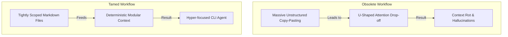
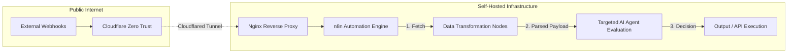

---

# Summary

There comes a point in every developer's journey where the tools that once accelerated execution become the very bottlenecks choking it. This document chronicles the architectural migration from casual, browser-based LLM interactions to a rigorous, CLI-native workflow powered by deterministic automation and agentic orchestration. It details the failure points of manual prompting, the architectural logic behind moving to n8n, and the compounding returns of treating AI operations as infrastructure rather than magic.

---

## The Breaking Point: Context Rot and the Copy-Paste Trap

For a long time, the browser tab was my primary interface with AI. It was convenient, but convenience is often a trap. The breaking point arrived during complex refactors where I found myself mindlessly copy-pasting entire files into a chat window.

This manual data shuttling induced extreme context switching and inevitably led to "context rot." After a few iterations, the LLM would suffer from a U-Shaped attention drop-off—remembering the first instruction and the last, but completely hallucinating or dropping the crucial logic in the middle. If I needed to extract just the specific context I wanted, I couldn't. The AI was isolated in a browser window, functionally disconnected from my actual working environment: the terminal and the file system.

To survive, I ousted the browser. By shifting to CLI-native LLMs, I brought the engine directly to the codebase. Instead of throwing raw text at a web interface, I fed the model tightly scoped, modular Markdown files. Precision replaced hope.

## Systems Engineering Over Prompt Engineering

Prompting is not a dark art; it is a systems engineering problem. I migrated from hopeful requests to rigorous architectures leveraging Mixture of Experts (MoE), explicit Personas, Chain of Thoughts, and Chain of Verification. By enforcing rigid constraints, engineered failure passes, and few-shot examples, reliability skyrocketed.

I stripped away the abstraction and treated LLMs as internal components, manually mapping parameters like Temperature, Top-P, and Frequency Penalty to the nature of the task. Need strict code generation? Zero variance. Need architectural ideation? Dial up the temperature.

## Architecting Determinism and the n8n Decision

You cannot orchestrate what you haven't automated. By late 2025, it became clear that relying on unpredictable LLMs to fetch and transform systemic data was a liability. I needed a deterministic pipeline to handle the plumbing before the AI touched the payload.

I evaluated the automation landscape and chose **n8n**. The architectural logic was absolute: it strikes the exact balance between coding practicality and visual simplicity. Unlike SaaS tools (Zapier, Make), n8n can be self-hosted, granting absolute control and security. Unlike writing raw Python cron jobs, its node-based approach eliminates boilerplate code overhead.

To expose this infrastructure safely, I routed external webhooks through Cloudflare Zero Trust and a Cloudflared Tunnel into an Nginx reverse proxy. Zero compromise on security, absolute flexibility for incoming triggers.

## The Compounding ROI of Micro-Automations

Theory is useless without metrics. I deployed this architecture to build an AI Gmail Labeler. Using n8n data transformations feeding into a targeted agent, incoming emails are now processed, evaluated, and routed deterministically.

The tangible ROI? It saves me roughly 10 seconds of my life on every single email I receive. While 10 seconds sounds trivial in isolation, multiplied by daily inbound volume, it represents a massive reduction in cognitive load and context switching. I am no longer manually triaging requests; the system handles the noise deterministically while I focus on high-value engineering execution.

---

# Conclusion

The transition from a casual browser-based consumer to a CLI-native orchestrator of deterministic pipelines required unlearning bad habits, battling context rot, and embracing self-hosted infrastructure. The ROI is undeniable: extreme speed, zero-trust security, and flawless context-retention.

Your workflow might be obsolete today, but the defining trait of an engineer is the capacity to rewrite it.
